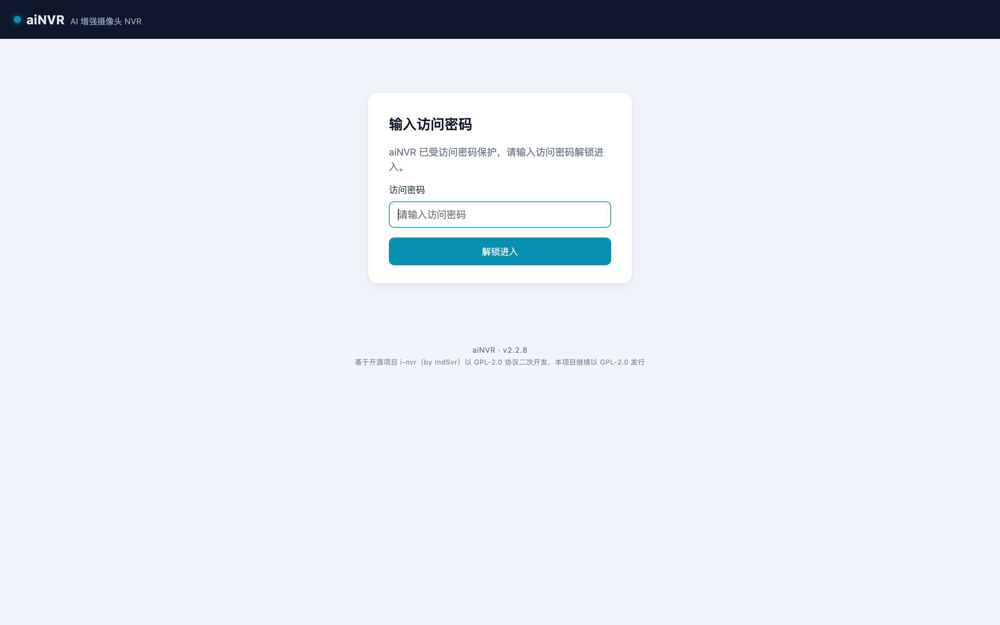
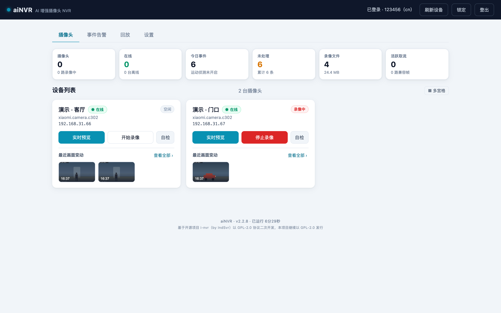
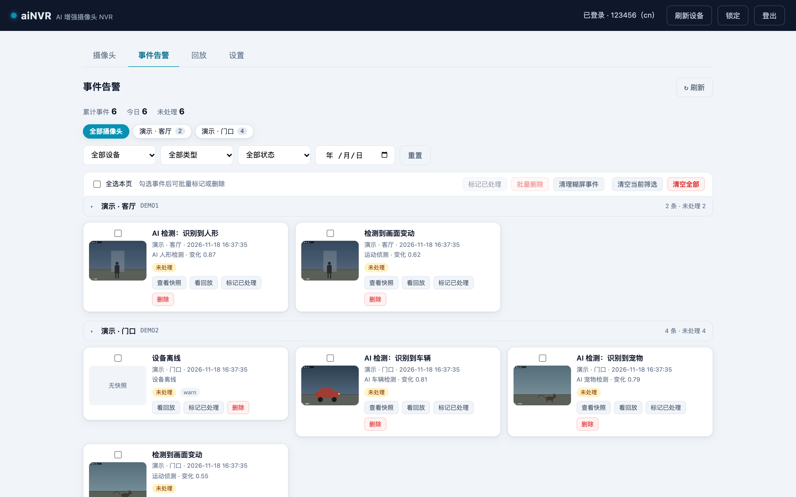
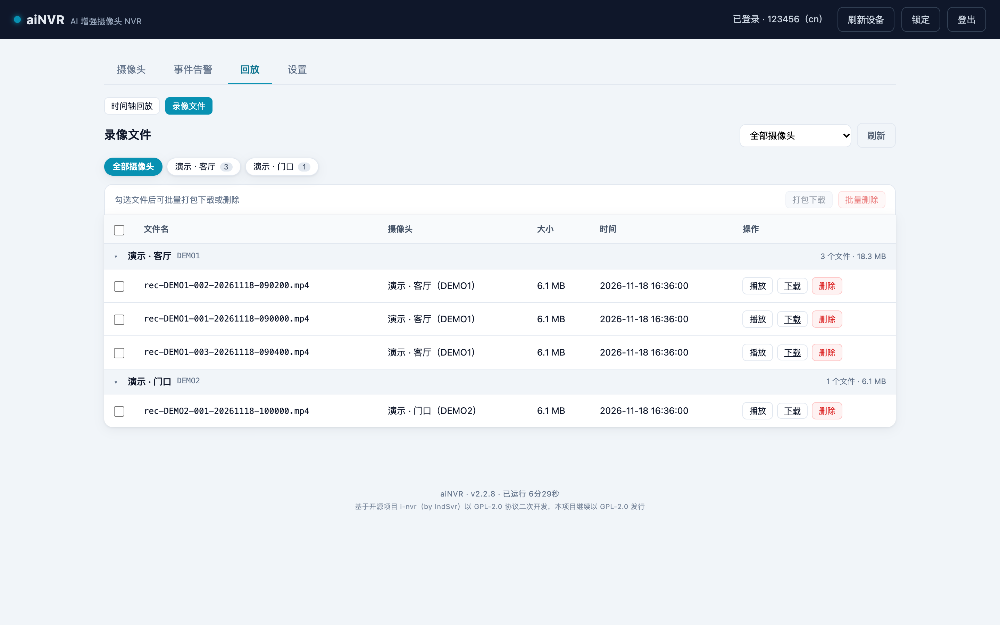
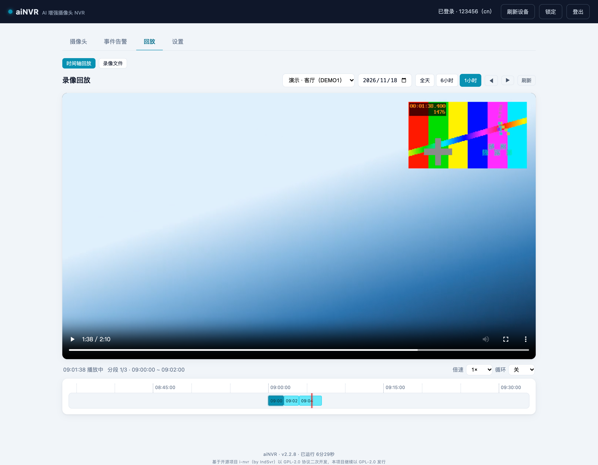
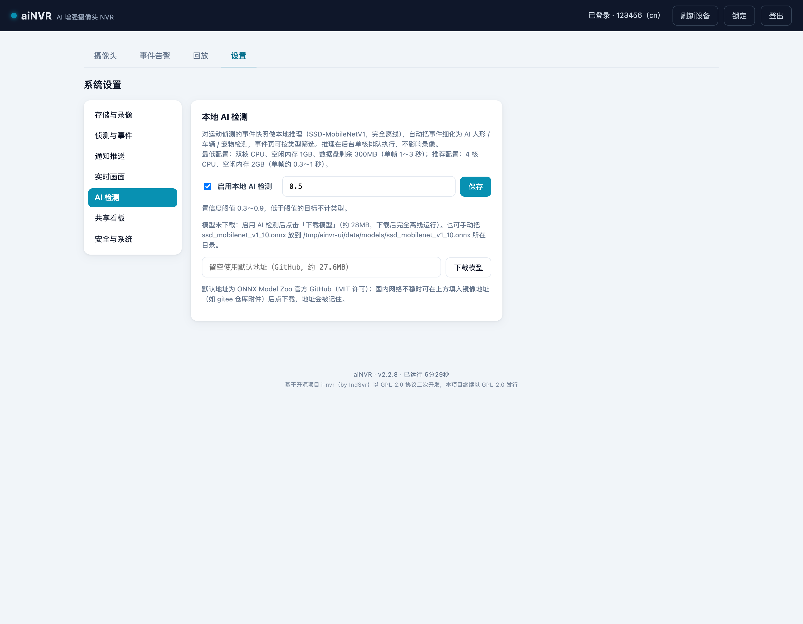
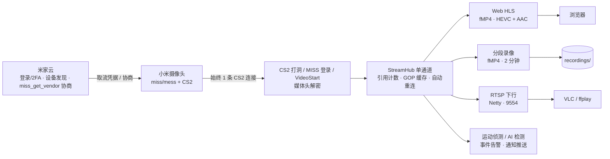

# aiNVR · AI 增强小米摄像头 NVR

> 纯 Java 自研的小米摄像头网络录像服务（NVR），在上游开源项目 **i-nvr**（by IndSvr，GPL-2.0）基础上深度二次开发：在「私有协议直连 + 单通道复用」的取流底座之上，补齐了**画面变动侦测、事件告警、本地 AI 识别（人 / 车 / 宠物）、自动录像、通知推送、免登录共享大屏**等一整套 NVR 应用能力，以飞牛 fnOS 应用（fpk）形态交付，开箱即用。

`Java 17` · `Spring Boot 3` · `Netty` · `JavaCV(FFmpeg)` · `ONNX Runtime` · 无外部流媒体进程 · 无需刷固件

- 官网：<https://ainvr.zsunny.top>
- 上游项目：i-nvr by IndSvr（GPL-2.0），本仓库延续 GPL-2.0 发行并在应用内保留署名；
- 版本下载（主渠道）：[GitHub Releases](https://github.com/zsunny6658/ai-nvr/releases)，也可从官网直接下载应用包；
- 代码仓库：GitHub [zsunny6658/ai-nvr](https://github.com/zsunny6658/ai-nvr) · Gitee 镜像 [sunnymore/ai-nvr](https://gitee.com/sunnymore/ai-nvr)。

---

## 功能特性

### 取流与录像（上游底座）

- **私有协议直连**：仅走小米统一的 miss/mess + CS2 协议（适用于 2020 年后机型），不需要摄像头开启 RTSP/ONVIF，也不依赖云录像；不做 legacy / TUTK 老协议。
- **单通道复用（核心）**：`StreamHub` 以引用计数方式做扇出，网页预览、RTSP 拉流、分段录像任意组合，对摄像头始终只建立 **1 条 CS2 连接**；内置 GOP 缓存（拉流秒开）、有界队列背压与断流自动重连。
- **米家账号登录**：Web 端完成登录，支持图形验证码、短信 / 邮箱二次验证（2FA）；会话凭据 AES-GCM 加密本地存储，重启免密恢复。
- **实时预览**：HLS over **fMP4（CMAF）**，视频 HEVC/H.264 原样、音频转 AAC，浏览器原生播放（无需插件），约 2–4 秒延迟；多宫格（2×2 / 3×3）+ 15/30 秒自动轮巡。
- **标准 RTSP 下行**：用 Netty 手写 RTP-over-TCP 服务，`rtsp://主机:9554/<did>`，VLC / ffplay / 第三方播放器直接拉流（H265 / H264 + Opus），支持可选访问令牌鉴权。
- **分段录像**：fMP4（CMAF）默认 2 分钟一段、按 IDR 边界对齐；**边录边播**，崩溃 / 断电只丢最后约 1 个 GOP；持续录像重启自动续录；支持容量水位循环覆盖与保留天数双重清理。

### 侦测 · 事件 · AI（aiNVR 二开线）

- **画面变动侦测**：8×8 灰度感知哈希帧差，复用预览兼容帧、不额外占用取流通道；稳定基准帧 + 连续帧确认 + 触发冷却 + 云台静默 + 低照度跳过；ROI 排除区域（树影 / 马路 / 常亮屏幕不再误报）、侦测时段计划（支持跨午夜）、灰屏 / 糊屏快照多重过滤。
- **运动触发自动录像**：检测到变动即开录、画面静止按尾延时自动封段停录；用户手动停止后有冷却保护，重启后自动收敛。
- **事件告警中心**：按摄像头分组的时间倒序列表，未处理角标、快照大图、批量标记 / 删除 / 清空、糊屏快照一键清理；持续变动合并（×N 计数，快照换最新帧）。
- **本地 AI 检测**：SSD-MobileNetV1（ONNX，MIT 许可）完全离线推理，把变动事件自动细化为 **AI 人形 / 车辆 / 宠物检测**，事件页可按类型筛选；模型按需下载（官方 GitHub / 自定义镜像 / 手动放置），附最低与推荐配置说明；推理后台单核排队，不影响录像。
- **事件通知推送**：Webhook（POST JSON 事件载荷，可选 HMAC-SHA256 `X-aiNVR-Signature` 验签）与 SMTP 邮件双通道；按事件类型过滤、跨午夜静默时段、失败自动退避重试，一键发送测试。

### 回放与展示（aiNVR 二开线）

- **时间轴回放**：按天时间轴 + 变动事件绿色刻度；录像块内直接显示开始时间，悬停 / 拖动出现实时时间气泡；**分段无缝接续**（双缓冲预载，一段播完零加载切下一段）；单段 / 当天循环播放；0.5×~16× 倍速（超 4× 自动静音）；空格 / 方向键等快捷键。
- **事件直达回放**：事件快照一键跳转回放页，自动定位到事件时刻连续播放。
- **共享看板（免登录大屏）**：4 / 9 / 6（1 大 5 小）宫格，免鉴权共享链接可直接配置到 Android TV 长期展示，支持过期时间；外部事件系统通过 Webhook 驱动事件摄像头全屏，60 秒自动复原。

### 系统能力（aiNVR 二开线）

- **访问安全**：访问密码门禁（PBKDF2WithHmacSHA256），记住解锁 / 一键解锁链接、URL 令牌（`__ainvr_t`）；「会话密钥由访问密码派生」opt-in 加固。
- **开放接口（API 密钥）**：`GET /api/snapshot/<did>` 按 DID 实时截帧，`X-API-Key` 鉴权，密钥只存 SHA-256 摘要且仅对只读接口生效。
- **配置备份与恢复**：全部应用设置 / 共享看板 / 访问密码凭据一键导出为 JSON，导入即生效。
- **存储管理**：fnOS 授权目录 / 任意盘位选择，中间层级逐级下钻，中文目录名 UTF-8 修复，目录容量水位循环覆盖。
- **自检与运维**：设备一键自检 / 深度探测（编码、分辨率、取流健康度），版本与运行时长展示，设置页分组导航。
- **监控台界面**：深色监控台主题为默认（可在「设置 → 外观」切换浅色并记忆）；桌面侧栏 / 移动端底部导航，未处理事件在导航上红点提醒；摄像头卡顶部展示最近快照（点击直接进入实时预览，随概览自动刷新，可关闭）。
- **飞牛 fnOS 应用**：`-Pfnos` 打包 fpk，应用中心安装 / 覆盖升级，数据目录自动迁移，GPLv2 LICENSE 随包。

---

## 界面预览

> 深色监控台界面（默认主题），以下截图均为合成演示数据（演示摄像头 / 演示事件），不含任何真实画面。

### 访问密码门禁

首次登录米家账号后设置访问密码，之后每次打开都需要解锁；也可生成一次性 / 一键解锁链接。



### 监控台总览与设备列表

左侧导航（未处理事件红点提醒）+ 概览统计条；摄像头卡顶部为最近快照，点击画面直接进入实时预览，在线 / 离线 / 录制中徽标与操作按钮一目了然，卡底是米家式「最近画面变动」快照条。



### 事件告警与本地 AI 检测

事件按摄像头分组，本地 AI 把变动事件细化为 AI 人形 / 车辆 / 宠物检测（带置信度），支持快照大图、直达回放、批量处理与按类型筛选。



### 录像文件

2 分钟一个 fMP4 分段，支持在线播放、下载、删除，可按摄像头筛选；正在写入的分段才标记"录制中"。



### 时间轴回放

按天时间轴，青色块即录像段（块内直接显示开始时间），红色游标为当前位置；点击任意录像段自动连续播放，分段自动无缝接续，支持循环与 0.5×~16× 倍速。



### 系统设置

分组导航：存储与录像 / 侦测与事件 / 通知推送 / 实时画面 / AI 检测 / 共享看板 / 安全与系统 / 外观（界面主题与摄像头卡快照开关）。



---

## 工作原理

整体上行只走小米私有协议，下行在 `StreamHub` 处做单通道扇出：



无论网页预览、RTSP、录像同时开多少路，`StreamHub` 对同一摄像头只维持一条上游连接；最后一个消费者退出后自动释放并在需要时重连。

---

## 快速开始

### 飞牛 fnOS 用户（推荐）

下载 GitHub Releases（或官网 <https://ainvr.zsunny.top/downloads/ainvr.fpk>）中的应用包，在飞牛 App 中心手动上传安装，按向导登录米家账号即可。覆盖升级保留全部配置与录像。

### 源码运行

#### 环境要求

- JDK 17 或以上（JDK 21 亦可）
- Maven（仓库内置 `maven-settings.xml`，走阿里云镜像，不污染全局配置）

#### 构建

```bash
git clone https://github.com/zsunny6658/ai-nvr.git
# Gitee 镜像：git clone https://gitee.com/sunnymore/ai-nvr.git
cd ai-nvr

# 通用 fat jar（Windows + Linux 双平台 native）
mvn -s maven-settings.xml package
# 产物：target/ainvr-fnos.jar

# 飞牛 fnOS 精简包（仅 Linux x86_64 native，体积更小）
mvn -s maven-settings.xml -Pfnos package
```

#### 启动 Web 服务

```bash
java -jar target/ainvr-fnos.jar
```

浏览器打开 `http://<主机IP>:9080`：

1. 首次进入在页面登录米家账号（图形验证码 / 短信验证码按提示完成）；
2. 登录成功后设置访问密码并进入系统；
3. 在「摄像头」页点击 **实时预览** 看画面，或点击 **开始录像** 持续录像；
4. 在「回放」页通过时间轴回看历史录像；
5. 在「设置 → 侦测与事件」开启画面变动侦测（默认关闭），按需在「AI 检测」启用本地 AI 并下载模型。

### 用 RTSP 拉流

Web 服务启动后，内嵌 RTSP 服务同时就绪（默认 `9554`），第三方播放器直接打开：

```
rtsp://<主机IP>:9554/<摄像头DID>
例如：rtsp://192.168.1.10:9554/1190193414
```

若设置了 RTSP 访问令牌，地址需带 `?t=<token>`。

### 用 API 密钥截取实时画面（开放接口）

在控制台「设置 → 安全与系统 → 开放接口 · API 密钥」生成随机密钥（也可保存 16～80 位自定义密钥），完整明文仅在生成 / 保存当次展示。外部系统调用时在请求头携带 `X-API-Key`，返回 `image/jpeg` 二进制：

```bash
curl -H "X-API-Key: ainvr_xxxxxxxxxxxxxxxxxxxxxxxxxxxxxxxx" \
  "http://<主机IP>:9080/api/snapshot/<摄像头DID>" \
  --output snapshot.jpg
```

说明：

- 截帧复用 `StreamHub` 同一条摄像头上游（与预览 / 录像共享 GOP 缓存），热态下毫秒级出帧；冷启动需等待建连与首个关键帧，服务端最长等待 20 秒，超时返回 `503`。
- API 密钥只对 `GET /api/snapshot/**` 这一只读接口生效；设备、设置、录像等管理接口即使携带正确密钥也会返回 `401 API_KEY_INVALID`。
- 未携带密钥返回 `401 ACCESS_LOCKED`；密钥错误 / 用在未授权接口返回 `401 API_KEY_INVALID`；设备不存在返回 `404`、设备离线返回 `503`。重新生成或删除密钥后旧密钥立即失效。
- 服务端仅保存密钥的 SHA-256 摘要（`.ainvr/api-key.json`），不存明文。

### 配置共享看板（免登录大屏）

1. 在控制台「设置 → 共享看板」新建看板，选择布局（4 / 9 / 6 宫格）并按槽位分配摄像头，可设置过期时间（留空永久有效）；
2. 复制生成的**共享链接**，直接配置到 Android TV 浏览器或任意浏览器，无需登录即可长时间展示，同一链接可同时开在多台电视上；
3. 看板同时提供独立的 **Webhook 密钥**，外部事件系统在摄像头有事件时调用：

```bash
curl -X POST "http://<主机IP>:9080/share-event" \
  -H "X-Share-Secret: <webhookSecret>" \
  -H "Content-Type: application/json" \
  -d '{"did":"1190193414","eventType":"motion"}'
```

事件摄像头在 4 / 9 宫格下全屏展示、6 宫格下进入大格（与默认主摄像头单次交换），默认 60 秒后自动复原；窗口内新事件直接覆盖并重新计时。

### 常用配置

在 `src/main/resources/application.yml` 中调整，或用命令行参数覆盖（配置前缀 `ainvr.*`）：

| 配置 | 默认值 | 说明 |
| --- | --- | --- |
| HTTP 端口 | `9080` | Web 控制台与 API |
| RTSP 端口 | `9554` | 内嵌 RTSP 下行 |
| RTSP 令牌 | 空（不鉴权） | 非空时 RTSP 地址须带 `?t=<token>` |
| 录像目录 | `recordings` | fMP4 分段存放目录 |
| 分段时长 | `120`（秒） | 每个 fMP4 片段时长，按 IDR 对齐 |
| HLS 分片 | `2` 秒 / 窗口 `6` | 网页预览延迟与缓存 |
| 音频转码 | `true` | HLS 把 Opus 转 AAC，失败自动降级静音 |
| 会话密钥派生 | `false`（opt-in） | 开启后米家会话由访问密码派生加密 |
| 事件持续 | `60`（秒） | 共享看板事件画面时长，到期复原 |
| SSE 心跳 | `15`（秒） | 维持事件长连接 |
| 大屏兜底重载 | `3600`（秒） | 展示页定时重载，`0` 关闭 |
| 配置轮询 | `60`（秒） | 展示页配置/设备状态兜底轮询 |

示例：

```bash
java -jar target/ainvr-fnos.jar --server.port=8080 --ainvr.rtsp-port=8554
```

### 数据与存储

- **数据目录**默认在程序运行目录下的 `.ainvr/`（会话密钥、访问密码、API 密钥摘要、录像状态等），录像默认在运行目录下的 `recordings/`，随程序目录一起迁移；
- 可用 `-Dainvr.data.dir=<目录>` 或环境变量 `AINVR_DATA_DIR` 指定数据目录；
- 海外区域设置环境变量 `AINVR_REGION`（de / i2 / ru / sg / us），默认中国区 `cn`。

### CLI 调试（可选）

CLI 入口 `com.ainvr.AinvrApplication` 主要用于协议调试，可通过 Maven exec 运行：

```bash
mvn -s maven-settings.xml exec:java -Dexec.args="devices"        # 列出摄像头
mvn -s maven-settings.xml exec:java -Dexec.args="stream <did> 30" # 裸流落盘自检
```

---

## 工程结构

```
src/main/java/com/ainvr/
├── AinvrApplication.java  # CLI 入口（协议调试）
├── cloud/    # 米家云：登录(验证码/2FA)、业务 API 签名、设备发现、miss_get_vendor 协商
├── crypto/   # RC4 / X25519 / ChaCha20 等加解密
├── p2p/      # CS2 UDP 打洞、TCP 传输、DRW 帧、DataChannel 重组
├── miss/     # MISS 登录、加密命令、VideoStart 取流
├── hub/      # StreamHub 单通道扇出（引用计数 / GOP 缓存 / 自动重连）
├── codec/    # 码流解析（Annex-B / AVCC、参数集等）
├── hls/      # HLS fMP4(CMAF) 输出（HEVC + AAC）
├── rtsp/     # Netty 手写 RTSP 下行（RTP-over-TCP）
├── record/   # fMP4 分段录像（边录边播 / 崩溃保全 / 分段接续）
├── store/    # 会话、访问密码、录像状态的本地加密存储
├── web/      # Spring Boot 控制台、REST API、门禁、运动侦测、AI 检测、事件与通知、静态页面
├── model/    # 设备 / 连接参数模型
└── util/     # 通用工具
```

---

## 安全加固

项目对本地凭据做了如下加固，并保留向后兼容的默认行为：

- **访问密码**：采用 `PBKDF2WithHmacSHA256` + 每密码独立 16 字节随机盐 + 12 万次迭代派生，落盘仅存盐 / 哈希 / 迭代次数，无明文；最低 10 位。
- **记住解锁令牌**：由访问密码经同一 PBKDF2 派生出 32 字节会话密钥后做 URL-safe base64 编码；`access.json` 只存该令牌的二次 SHA-256，离线爆破访问密码的成本等同于 PBKDF2，而非单次 SHA-256。
- **RTSP 下行访问令牌（可选）**：设置 `ainvr.rtsp-token` 为非空字符串后，所有 RTSP 请求须带 `?t=<token>` 且值匹配才放行（默认不鉴权）。`/api/devices` 返回的 `rtspUrl` 与共享看板的 `rtsp.token` 会自动携带该令牌。
- **会话密钥由访问密码派生（opt-in）**：设置 `ainvr.session-key-from-password: true` 后，米家会话不再使用与密文同目录的 `master.key`，而是用访问密码派生的密钥加密；启动时不自动恢复，需先用访问密码解锁（安全性更高）。旧版 `master.key` 加密的会话在切换后需重新登录一次米家账号。
- **Webhook 验签**：事件通知可选 HMAC-SHA256 签名（请求头 `X-aiNVR-Signature`），接收端可校验载荷完整性与来源。

> 部署建议：经反向代理开启 HTTPS 后再对外暴露，并对来源 IP 做限制；RTSP / Web 控制台不要直接以 `0.0.0.0` 暴露到公网。共享看板链接含免登录能力，请仅对可信大屏分发并尽量设置过期时间。

## 支持范围与说明

- 适用于 **2020 年之后采用统一协议（miss/mess + CS2，vendor=4）的小米 / 米家摄像头**；真机验证机型为 `xiaomi.camera.c302`（H.265 3.5K + Opus）。
- 不支持 legacy / TUTK 老机型，也不做 RTSP / ONVIF 上行接入。
- 摄像头固有约分钟级的断流，由自动重连与 GOP 缓存兜底，无需人工干预。

## 合规与免责

- 本项目基于上游开源项目 **i-nvr**（by IndSvr）以 **GPL-2.0** 协议二次开发，整体继续以 GPL-2.0 发行，保留原作者版权与许可声明；二开新增部分同为 GPL-2.0。
- 本项目**仅用于接入本人自有摄像头，并在局域网 / 受信网络内使用**，请勿用于监控他人或违反当地法律法规。
- 这是一个**非官方逆向协议实现**，不提供任何可用性保证；小米云端或固件升级可能导致协议失效，需自行评估使用风险。
- 协议实现参考了 [go2rtc](https://github.com/AlexxIT/go2rtc)（MIT，仅作协议蓝本）与 MiBeeNVR 的架构思路（AGPL-3.0，未直接使用其代码）；AI 检测模型 [SSD-MobileNetV1](https://github.com/onnx/models)（ONNX Model Zoo，MIT）。

## 相关文档

- 详细设计文档：[`docs/design/01-xiaomi-protocol-design.md`](docs/design/01-xiaomi-protocol-design.md)
- 共享看板设计文档：[`docs/design/02-shared-board-design.md`](docs/design/02-shared-board-design.md)
- RTSP 大屏客户端：[`wall-client/README.md`](wall-client/README.md)
